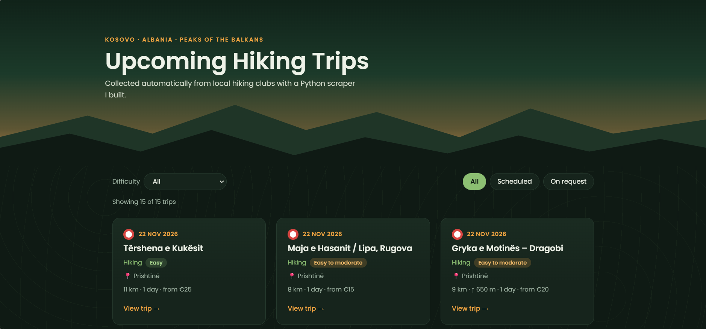

# Kosovo Hiking Trips

Hiking clubs in Kosovo post their weekend trips in many different places: websites, Instagram, Facebook.
This project collects them into one clean feed and shows them on a simple web page.

**Live demo:** https://yllkaejupi.github.io/kosovo-hiking-trips/



**Stack:** Python, Requests, BeautifulSoup, JSON/CSV, JavaScript, HTML/CSS, Git, GitHub Pages

## How it works

1. **Python scraper** visits club websites, extracts each trip, cleans the data and saves it as JSON and CSV.
2. **Manual trips** from clubs that only post on Instagram/Facebook are added by hand in `data/manual_events.json` and merged in.
3. **Web page** (`docs/`) loads the JSON and shows the trips as cards with filters.

## Features

### Scraper
- Two-step crawl: listing pages (with pagination) -> each trip page
- Reads fields by their labels, not their position, so reordered rows don't break it
- Cleans data: ISO dates, numbers from text ("1,960 m" -> 1960), "4 Hours" vs "4 Days", emoji removal
- Handles tours with no fixed date ("Dates on request")
- Removes duplicates by id and by title + date, also across sources
- Handles errors: timeouts and retries; broken pages are skipped and logged
- Polite: custom User-Agent, delay between requests, respects robots.txt
- Tested with pytest using a saved sample page

### Web page
- Trip cards with date, difficulty badge, location, distance, elevation gain and price
- Filters by difficulty and by scheduled / on-request trips
- Hides trips that are already over
- Escapes all scraped text before displaying it (protection against XSS)
- Responsive grid, works on phones without media queries

## Project structure

```
├── main.py                  # runs everything: scrape -> merge -> dedupe -> save
├── scraper/
│   ├── http.py              # downloading: delay, retries, timeouts, robots.txt
│   ├── cleaning.py          # turning messy text into clean values
│   ├── storage.py           # duplicates + saving
│   └── sources/
│       └── shtegtimi.py     # reads trips from shtegtimi.com (uses BeautifulSoup)
├── data/
│   ├── events.json          # all trips (output)
│   ├── events.csv           # same trips, for Excel / Google Sheets (output)
│   └── manual_events.json   # trips added by hand
├── docs/                    # the web page (served by GitHub Pages)
│   ├── index.html
│   ├── hikes.js
│   ├── style.css
│   └── hikes.json           # copy of the trips that the page loads
└── tests/                   # pytest tests + a saved sample page
```

## How to run

You need Python 3.10 or newer.

```bash
pip install -r requirements.txt

python main.py              # scrape everything and save the results
python main.py --limit 2    # only 2 trips per site (quick test)
python -m pytest            # run the tests
```

After a run, the new trips are in `data/events.json`, `data/events.csv` and `docs/hikes.json`.

To see the web page on your computer, open `docs/` with a local server
(for example `python -m http.server -d docs`) and go to http://localhost:8000.

## Adding a trip by hand

For clubs that only post on Instagram or Facebook, add the trip to `data/manual_events.json`
and run `python main.py` again. Copy an existing entry and change the values.
The `id` must start with `manual:` and should be unique, for example `manual:club-mountain-2026-12-06`.

## Adding a new website

1. Create a new file in `scraper/sources/`, for example `newclub.py`.
2. Write a `scrape(fetcher, limit=None)` function that returns a list of trips
   with the same fields as the other trips.
3. Add it to the list of sources in `main.py`: `for source in [shtegtimi, newclub]:`